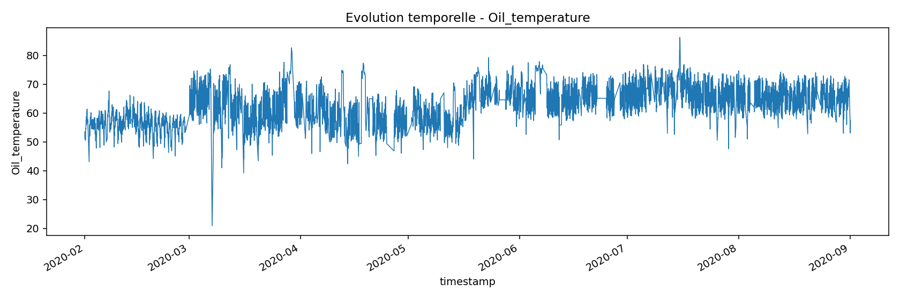
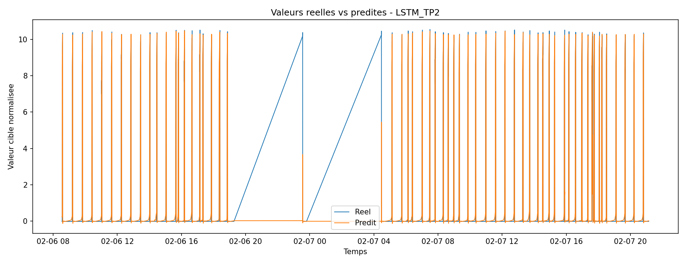

# Détection d'anomalies IoT sur un compresseur d'air industriel

Pipeline Data/IA de bout en bout sur des données réelles de capteurs IoT (dataset public **MetroPT-3**) : ingestion, nettoyage, base SQL, analyse exploratoire, prévision de la température d'huile (baseline, LSTM, Transformer), détection d'anomalies non supervisée (Autoencoder), génération d'alertes et exports pour Power BI.

**Stack :** Python · Pandas · NumPy · Scikit-learn · TensorFlow/Keras · SQLAlchemy · SQLite · Matplotlib · Power BI



## Données

[MetroPT-3 (UCI Machine Learning Repository)](https://archive.ics.uci.edu/dataset/791/metropt+3+dataset) : capteurs de l'unité de production d'air d'un train de métro.

| | |
|---|---|
| Mesures | 1 516 948 lignes, 16 variables |
| Période | 1er février → 1er septembre 2020 (213 jours) |
| Capteurs | pressions (TP2, TP3, H1, DV_pressure, Reservoirs), température d'huile, courant moteur, signaux de composants |
| Compresseur actif (COMP = 1) | 83,7 % des mesures |

Le CSV n'est pas versionné (environ 200 Mo). Le télécharger et le placer dans `data/raw/MetroPT3(AirCompressor).csv`.

## Architecture

```text
main.py                  pipeline complet (options en ligne de commande)
src/
  preprocessing.py       chargement, tri chronologique, doublons, interpolation, normalisation
  feature_engineering.py séquences temporelles
  database.py            tables SQLite : mesures, prédictions, anomalies, métriques
  reporting.py           EDA, KPI, exports Power BI
  train_lstm.py          prévision LSTM
  train_transformer.py   prévision Transformer (attention)
  train_autoencoder.py   détection d'anomalies multivariée
  anomaly_detection.py   seuils et alertes (sévérité, capteur, message)
  evaluation.py          RMSE, MAE, R², comparaison des modèles
notebooks/               une étape par notebook (EDA → autoencoder)
models/                  modèles entraînés (.h5) et scalers
data/results/            métriques, statistiques et figures
dashboard/               KPI pour Power BI
```

## Lancement

```bash
pip install -r requirements.txt
python main.py --sample-size 100000            # test rapide
python main.py --sample-size 100000 --epochs 5 --sequence-length 30
python main.py --filter-comp-active            # uniquement compresseur actif
python main.py                                 # dataset complet
```

## Résultats : étude multi-capteurs (20 epochs)

Code et résultats complets dans [`etude_multi_capteurs/`](etude_multi_capteurs/) : 50 000 mesures, découpage temporel (39 940 séquences d'entraînement, 9 940 de test), séquences de 60 pas, scaler ajusté uniquement sur la période d'entraînement (pas de fuite de données), 5 capteurs cibles, sélection des variables par corrélation.

| Capteur cible | RMSE LSTM | RMSE Transformer | RMSE baseline naïve | R² LSTM | LSTM vs baseline |
|---|---|---|---|---|---|
| TP2 | **0,616** | 0,901 | 0,977 | 0,929 | erreur −37 % |
| TP3 | 0,080 | 0,467 | 0,063 | 0,980 | erreur +27 % |
| Reservoirs | 0,085 | 0,508 | 0,063 | 0,978 | erreur +34 % |
| Motor_current | 0,577 | 1,350 | 0,529 | 0,918 | erreur +9 % |
| Oil_temperature | 2,192 | 4,789 | 0,248 | 0,755 | erreur +783 % |

**Lecture :**
- Sur la pression **TP2**, le LSTM réduit l'erreur de **37 %** par rapport à la baseline naïve (RMSE 0,616 contre 0,977, R² 0,93).
- Sur les signaux très lisses (TP3, Reservoirs, Motor_current, Oil_temperature), la baseline « dernière valeur connue » reste meilleure : le projet la garde comme référence obligatoire pour ne pas surestimer l'apport du Deep Learning.
- Le Transformer est moins bon que le LSTM sur les 5 capteurs.
- **Autoencoder** (seuil au 95e percentile de l'erreur de reconstruction d'entraînement) : **3 561 anomalies sur 49 940 points (7,1 %)**.

Fichiers : [`metrics_report.csv`](etude_multi_capteurs/resultats/metrics_report.csv), [`anomaly_summary.csv`](etude_multi_capteurs/resultats/anomaly_summary.csv), [`academic_interpretation.md`](etude_multi_capteurs/resultats/academic_interpretation.md).



Relancer l'étude (CSV dans `data/raw/`) :

```bash
cd etude_multi_capteurs
pip install -r requirements.txt
python main.py
```

## Essai rapide du pipeline principal (échantillon de 100 000 mesures, 1 epoch)

| Modèle | Tâche | RMSE | MAE | R² |
|---|---|---|---|---|
| Baseline naïve (t-1) | Prévision Oil_temperature | **0,219** | **0,123** | **0,993** |
| LSTM | Prévision Oil_temperature | 2,626 | 2,131 | -0,022 |
| Transformer | Prévision Oil_temperature | 2,577 | 2,125 | 0,016 |
| Autoencoder | Détection d'anomalies | 5 012 anomalies (5,01 %), seuil au 95e percentile | | |

**Lecture :**
- La série de température d'huile est très lisse : la baseline naïve est très difficile à battre. Avec un seul epoch, le LSTM et le Transformer ne la dépassent pas. Le projet garde cette baseline comme référence obligatoire pour ne pas surestimer l'apport du Deep Learning.
- L'Autoencoder, entraîné sans labels, signale 5 % des séquences comme anormales. Dans cet échantillon, le capteur le plus souvent en cause est `Towers`.

## Limites et suite

- Pas de label d'anomalie dans les données : le seuil (95e percentile) doit être validé avec des experts métier. Le calcul de Precision / Recall / F1 est prêt si une colonne `anomaly_label` est ajoutée.
- Prochaines étapes : plus d'epochs et prévision à plusieurs pas (horizon où la baseline se dégrade), détection en streaming (MQTT / Kafka), évaluation sur les pannes documentées de MetroPT-3.

## Auteur

**Oussama EL BAZE** · Master 2 Ingénierie Informatique, EILCO · [LinkedIn](https://www.linkedin.com/in/oussama-el-baze-8137b9207/)
